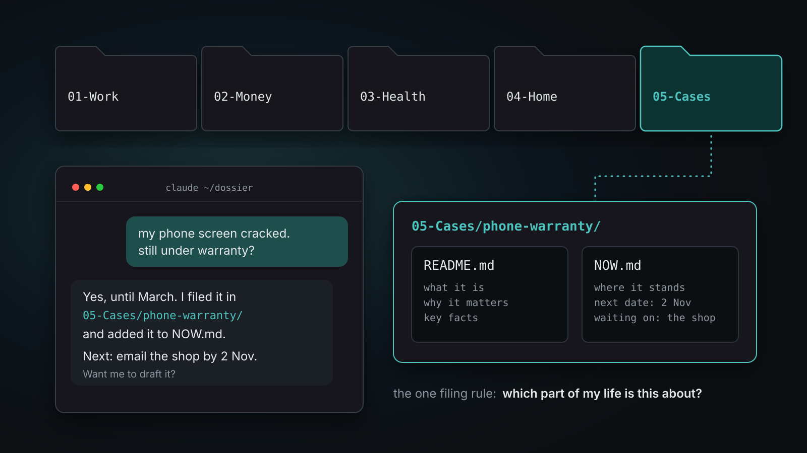
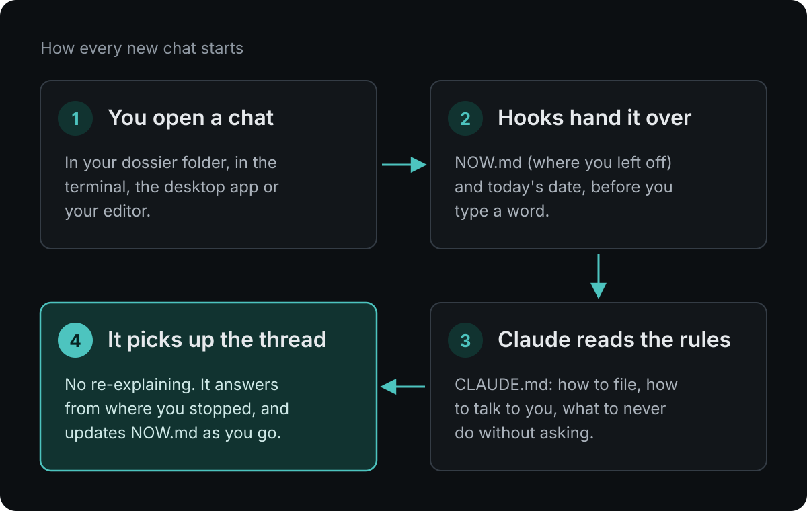
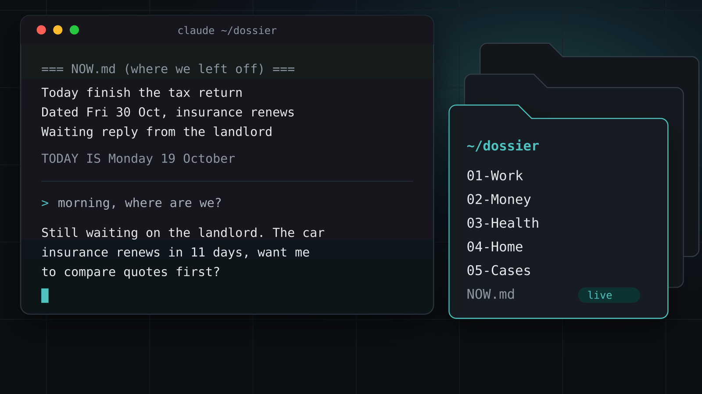

<p align="center">
  
</p>

<h1 align="center">Dossier Starter</h1>

<p align="center">
  A second brain for <a href="https://code.claude.com/docs/en/overview">Claude Code</a> that lives on your own computer.<br>
  Every chat starts where the last one stopped. Plain files, git, two small hooks. No extra app.
</p>

<p align="center">
  <a href="https://www.danielfrey.me/guides/claude-second-brain/"><b>Read the guide</b></a> ·
  <a href="https://github.com/clickspider/dossier-starter/archive/refs/heads/main.zip"><b>Download the zip</b></a> ·
  <a href="https://chat.whatsapp.com/HH1prNTbTLDELlhOO2r0jt"><b>Join the WhatsApp group</b></a>
</p>

---

## Start in one paste

Paste this into Claude Code. Claude downloads the starter, asks you a few short questions, and sets it up with you.

```text
Set up my personal dossier: a second brain for Claude Code that lives on my own computer.
1. Download https://github.com/clickspider/dossier-starter/archive/refs/heads/main.zip and unzip it to ~/dossier.
2. Read ~/dossier/SETUP.md and follow it with me.
3. Interview me one short question at a time.
4. Ask me before anything leaves my computer.
```

Then open a new chat in `~/dossier`. It starts from your `NOW.md`.

## What you get

| | Without it | With it |
|---|---|---|
| **New chat** | You explain your life again | Claude already has `NOW.md`: today, dates, what you wait on |
| **Rules** | You repeat "always ask before..." | Claude writes the rule into `CLAUDE.md` once, in your words |
| **Dates** | Claude guesses today's date | A hook gives it the real date on every message |
| **Files** | Notes everywhere | One home per topic, on numbered shelves |
| **History** | Gone when the chat ends | Every change is a git commit you can undo |
| **Your data** | In someone else's cloud | In one folder on your computer |

## How it works

<p align="center">
  
</p>

1. **`CLAUDE.md`**: the house rules. Claude Code loads this file at the start of every chat in the folder.
2. **`NOW.md`**: where you left off. Only live items, under ~40 lines.
3. **Start hook** (`.claude/hooks/session-start.sh`): prints `NOW.md`, so Claude has it before you type.
4. **Date hook** (`.claude/settings.json`): prints today's date on every message.
5. **`backup.sh`**: commits every change. Pushes only if you add a remote yourself.

<p align="center">
  
</p>

## What's inside

```
dossier/
├── CLAUDE.md        house rules for Claude
├── NOW.md           where we left off (max ~40 lines)
├── SETUP.md         the interview Claude runs with you
├── backup.sh        every change becomes a git commit
├── .claude/         the two hooks
├── 01-Work/         job, side projects, CV, applications
├── 02-Money/        budget, bills, subscriptions, taxes
├── 03-Health/       doctor visits, medication, training
├── 04-Home/         house, car, contracts, maintenance
├── 05-Cases/        claims, disputes, warranties, one folder each
└── _archive/        old files. Never delete, move here
```

Rename the shelves to fit your life. Every topic gets a folder with a `README.md` (what and why) and a `NOW.md` (where it stands).

## Set it up by hand

```bash
curl -L https://github.com/clickspider/dossier-starter/archive/refs/heads/main.zip -o dossier.zip
unzip dossier.zip && mv dossier-starter-main ~/dossier
cd ~/dossier && chmod +x backup.sh .claude/hooks/*.sh && git init -q -b main && ./backup.sh
claude
```

You need Claude Code and git.

## Privacy

Everything stays in this folder on your computer. Nothing is sent anywhere except your normal Claude conversations. This folder will hold your health, money and family notes, so if you back it up to GitHub, make that repo **private**.

## Coming next

Part 2: talk to your dossier from WhatsApp, running on your own laptop. It's in a security review now. The [WhatsApp group](https://chat.whatsapp.com/HH1prNTbTLDELlhOO2r0jt) gets it first.

## License

MIT. Take it, change it, make it yours. Made by [Daniel Frey](https://www.danielfrey.me).
